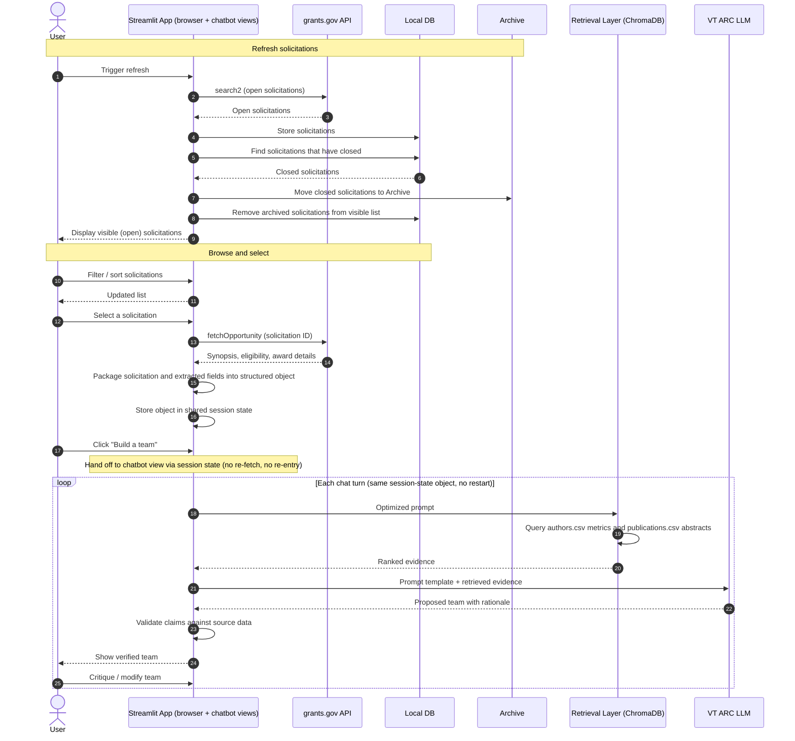

## Mid-term Project Definition

The project you are designing here is the **[Mid-Term Project Specifications](../projects/grant_teams_midterm_project/specifications.qmd)** — the grants.gov solicitation harvester and VT College of Science team builder. Read it end to end (requirements, use cases, deliverables, rubric, and the *Questions for Consideration*) before you start this exercise.

## Assignment Overview

Anyone can build an agentic system with Claude Code or Open Code.  _Can you build one that is reliable, safe, cost effective and meets all the requirements every time it's run?_  It's time to put on your AI architect hat and address LLM/RAG shortcomings with a good agentic AI design.

## Rubric

This is a 500 point exercise.  It's an assessment of how much you have learned up to this point.  Please take it seriously.  It's as important as the project output.  You should complete this Quarto markdown file (.qmd) and turn it in along (as .qmd) with a quarto rendered PDF version (.pdf).  Add `format: pdf` to the yaml header of this file and then run `quarto render yourfilename.qmd` to build the PDF.

## Important Note

This work must be done 100% without assistance from any AI.  I need to know that *YOU* have learned the material. I know that Claude knows it.  **Any use of AI will be easily detected and will be treated as an Honor Code violation.  Please take this seriously.**

## Requirements

Refer back to the course material in the `Projects` section and complete this list of requirements.  List as many as you can (20 is not meaningful here). This is a critical step!  Any person or LLM should be able to fully understand **all** requirements for the application from this list.

Complete this list:

1. The solution should provide a Python Streamlit interface in which a user can go from launch to a proposed team in no more than five interactions (refresh or browse, select, build a team, review, revise), and the interface should show a visible loading indicator during every API or LLM call.
2. The solution should harvest **open** solicitations from grants.gov via the REST API and store them in a local JSON database.
3. The solution should archive **closed** solicitations from grants.gov via the REST API so that they are not shown to the user.
4. The solution should grab authors from `authors.csv`, a file containing a list of CoS faculty with important metrics (such as the H5 index).
5. During development the solution shall read `publications.csv`; the production version shall retrieve publication data directly from the Elsevier API, behind the same retrieval interface..
6. The solution should be able to pull the latest grants.gov solicitations at any time.
7. The solution should be able to filter/sort the solicitations by type, date, amount, etc.
8. The solution should have the ability to select a solicitation and then click a button named `build a team`, where they will be transferred to a chatbot interface.
9. The solutions' chatbot interface should use RAG/GraphRAG to automatically build a team based on a user-defined prompt template + RAG content.
10. The solution should index faculty publications, abstracts, and metrics using ChromaDB and/or Neo4j.
11. The solution should extract key technical domains, eligibility criteria and required methodology from grants.gov solicitation text using the `fetchOpportunity` endpoint.
12. The RAG retrieval pipeline should rank faculty members with a deterministic score: final score = 0.6 × semantic similarity of their publications to the solicitation keywords + 0.25 × normalized H5-index + 0.15 × normalized citation volume. The weights should be stored in a configuration file and must not be set or changed by the LLM.
13. The solution should assign each selected individual one role from a defined list (Principal Investigator, Co-Principal Investigator, Methods/Technical Lead, Domain Expert, Data/Computational Specialist, Project Coordinator). Every team must include at least one Principal Investigator and one additional role, and no person may be assigned more than one role
14. The solution should utilize an LLM-based prompt optimization step to improve raw user inputs before running vector/graph queries and final response generation.
15. The chatbot should support the ability for the user to critique and modify the proposed teams.
16. The solution must interface with VT Advanced Research Computing (ARC) hosted LLM endpoints ([https://llm-api.arc.vt.edu/api/v1](https://llm-api.arc.vt.edu/api/v1)) using OpenAI-compatible API schemas.
17. The solution should take a holistic approach to building the team.  Contributor metrics, along with publications (including recency and journal prestige) at a minimum should be inputs into the team construction and role definitions.
18. The solution should verify all facts presented through direct grounding in the source materials.  The user should be able to trace back any factual claims to the original source material text.
19. The solution should highly reliable.  Running the same prompt over again should generate relatively consistent results.  If the results are wildly different, the solution is a complete failure and will never be accepted.
20. All API keys and base URLs must be stored in a .env file and never hardcoded into the source code.
21. The system must optimize retrieval chunk size, context window usage, and LLM call frequencies to maintain responsive generation times while minimizing token usage and API calls.
22. The solution must query grants.gov endpoint `search2` with `oppStatuses` set to `forecasted|posted` to get open work. No authentication is needed.
23. The solution must provide clear user messages if API failures, timeouts, or token limits occur on both the VT ARC LLM endpoint or Elsevier API.
24. The pass off between initial streamlit UI and chatbot should be seamless with no loss of data between the two.
25. The solution must produce a README.md file documenting the justification between the choice of RAG, GraphRAG, or hybrid.
26. The production version of the solution must retrieve publication metadata and abstracts for CoS faculty directly from the Elsevier API instead of `publications.csv`, with the API key stored in the .env file (requirement 20) and results cached locally to limit repeat calls.
27. For every proposed team member, the solution must present a rationale stating which solicitation requirements the person satisfies, which publications support that claim, and why they were assigned their role.

## LLM / RAG Issues

Referring back to the lectures on LLM and RAG, what are the specific issues that you must overcome with good agentic AI design/architecture/patterns **to meet the requirements**?  **Make sure you point back to a specific requirement**.  Don't solve the issue yet. Just identify it.  You should have a fair number of these (between 5 and 20).

1. For requirement 19, LLM sampling is probabilistic, so the same prompt and the same evidence can produce different teams on different runs.
2. For requirement 18, the model generates text that is statistically plausible rather than looked up, so it can hallucinate authors and publications that are not actually in the data.
3. For requirement 9, when using RAG, there comes the possibility that documents / information that aren't valuable to the situation can be grabbed.
4. For requirement 14, the LLM can produce a new prompt that might be subtly different that has drifted off from the original prompt.
5. For requirement 12, since the retrieval layer returns publication chunks, there's a possibility that one author who has produced a bunch of similar publications can blow up the results.
6. For requirement 12, LLMs are generally unreliable at combining numeric metrics like H5-index since they process text as tokens.
7. For requirement 21, retrieving abstracts and metrics for a large group of people can be very cost heavy and info can also get lost/ignored if buried in long context.
8. For requirement 13, assigning structured roles across a large team requires reasoning which LLMs handle poorly.
9. For requirement 15, when a user critiques the proposed team and wants to modify members, the model could possibly drop unrelated members.
10. For requirement 24, the pass off between homepage and chatbot could cause a loss in data, which would then cause a re-request of info or hallucinations.
11. For requirement 17, there's no optimal team for the given situation so the model has nothing to base its choices off of besides the numeric metrics and publications.

## Basic  Architecture

Write up a couple of paragraphs (in prose) on how you plan to design the solution.  What will be the general approach.  Don't solve the issues yet... just general approach.  What are the major pieces, how do they connect, etc.?

**25 Bonus points for including a UML sequence diagram using a mermaid diagram.** For this syntax (and only this syntax), I will allow LLM usage **but you need to prompt the LLM with the sequence diagram flow, actors and steps.  Include your prompt here.**

You should end your `Basic Architecture` with the level of agency you think is **earned** by this solution architecture.  Go back to the beginning of the course for the various levels.  **Make sure you give a quick summary of why it is earned.**

The solution will be architected as a two part Streamlit application with a local data layer and a chatbot that utilizes RAG. Both will be connected through a shared session state rather than separate, disconnected pages.

The first part of the application will call the grants.gov `search2` endpoint to pull in the open solicitations into a local database. When the query is re-run, it will move anything that has closed since the last query will be pushed into an archive, hidden from the user, so that the filters (browse/filter/sort) only ever shows currently open grants. When selecting a grant, the app will run the `fetchOpportunity` endpoint to retrieve the synopsis, eligibility, and award details to provide the user with more information. The app will package the solicitation and the extracted fields into a single structured object that gets passed into session state to be handed off to the chatbot so nothing has to be re-fetched or re-typed.

The second part of the application will be the chatbot view holding the solicitation object passed off by the initial UI. Under the chatbot will be the retrieval layer utilizing RAG and/or GraphRAG to grab the indexed `authors.csv` metrics and `publications.csv` abstracts (replaced by the Elsevier API in production, behind the same retrieval interface). They will be keyed together so the retrieved publications can be linked back to their associated faculty member. Retrieved authors will be ranked by a deterministic scoring function, and each chat turn will run the optimized prompt and the retrieved evidence through the VT ARC LLM endpoint to propose or revise a team. Any following turns will use the same solicitation object rather than starting over so the conversation stays grounded in the same underlying data.

Between the LLM and the user sits a validation and grounding stage. Every author, publication, and factual claim in the LLM's proposed team is checked against `authors.csv` and the publication source, and anything that cannot be matched is rejected or sent back for regeneration. Verified claims are attached to the source text they came from so the user can trace each one. Nothing reaches the user without passing through this stage, which makes it the component that enforces requirement 18.

The level of agency earned by this solution architecture is **workflow** due to its step-by-step architecture. Every step (calling `search2`, calling `fetchOpportunity`, running the retrieval query against ChromaDB, etc.) is wired together by the code in a fixed sequence. The LLM is never given a "catalog" of tools and told pick tools at times it finds necessary.

**Prompt:** Create a Mermaid UML sequence diagram for this architecture:
The system has three participants: User, Streamlit App (covering both the solicitation browser and chatbot views, connected via shared session state), and VT ARC LLM. Include these participants/systems as needed: grants.gov API, Local DB/Archive, Retrieval Layer (ChromaDB/RAG).
Sequence:

1. User triggers a refresh; Streamlit App calls grants.gov `search2` for open solicitations and stores them in the Local DB.
2. On refresh, any solicitation that has closed is moved to an Archive and excluded from the visible list.
3. User filters/sorts and selects a solicitation.
4. Streamlit App calls grants.gov `fetchOpportunity` for synopsis, eligibility, and award details.
5. Streamlit App packages the solicitation and extracted fields into a structured object and stores it in shared session state.
6. User clicks "build a team," handing off to the chatbot view (no re-fetch, no re-entry of data).
7. Chatbot view sends the optimized prompt to the Retrieval Layer, which queries indexed `authors.csv` metrics and `publications.csv` abstracts (keyed together).
8. Retrieval Layer returns evidence to the chatbot.
9. Chatbot sends the prompt template + retrieved evidence to VT ARC LLM.
10. VT ARC LLM returns a proposed team with rationale.
11. User critiques/modifies; the loop (steps 7–10) repeats using the same session-state solicitation object, without restarting.

## Solution Mitigation

Now for each of the LLM/RAG issues, you should give specific design patterns that we learned in class to address them.  I need a short explanation of why your solution is the right one.  **Make sure you refer back to the numbered issue from the previous section.**

1. For issue 1, we can tune the hyperparameters, adjusting the temperature to a level seen fit for the best results. This seems like the best design pattern because a lower temperature reduces *creativity* but doesn't guarantee identical outcomes.
2. For issue 2, we can implement **chain-of-verification** to confirm that the authors and publications produced by the model are actually valid. A lookup against the source data is the only true way to check for hallucinations.
3. For issue 3, we can run use a hybrid search to grab a large amount of documents and perform re-ranking to narrow our results down to the most relevant information. The first vector search is fast and cheap while the re-ranker would be most costly, but it would have a much more reduced set of documents to work with.
4. For issue 4, we should implement some sort of prompt construction using pieces of the structured solicitation object. Doing this, the LLM wouldn't rewrite the entire prompt, limiting the amount of drift that could possibly happen.
5. For issue 5, we can implement a 3-step process including grabbing a large amount of chunks, group chunks by author and assign each a author-level score, and then perform some diversity reranking like MMR. This design pattern helps us select the best authors fit for the jobs rather than just the best publications and hope they have different authors.
6. For issue 6, we can have a deterministic scoring function that performs that normalizes and weighs the metrics and passes it to the LLM for it to explain. We can use this function either in a deterministic process or as a tool call.
7. For issue 7, we can put the strongest candidates in the beginning and the end. Models tend to have a hard time finding content in the middle of long contexts, so we want to push it out.
8. For issue 8, we can perform a role-by-role decomposition where the LLM reads the solicitation and generates a list of roles it deems necessary. From there, we make a greedy choice and fill each role one at a time. This keeps out LLM calls small and prevents duplicates.
9. For issue 9, we keep the current team as an object and translate the user's critiques into operations. Only the affected slots go back to the LLM, keeping our desired members unchanged. With this pattern, the LLM will never redesign the whole team.
10. For issue 10, we can define a schema for the solicitation object, store it once in the Streamlit session state, and have the chatbot read it directly. This is the correct design pattern so we never have any data loss between the 2 stages.
11. For issue 11, we can have the LLM grab the solicitation's requirements, form it into a list, and score the candidate teams against the requirements using a hidden rubric.

## Final Thoughts

Hopefully, you can see that this exercise is something you do before invoking an agentic harness.  This is where you add value and earn your place in the future AI ecosystem.  Next steps we will review this architecture with a frontier level model and refine it.  Then we work with an agentic harness to build it!
